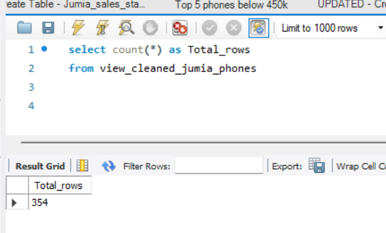
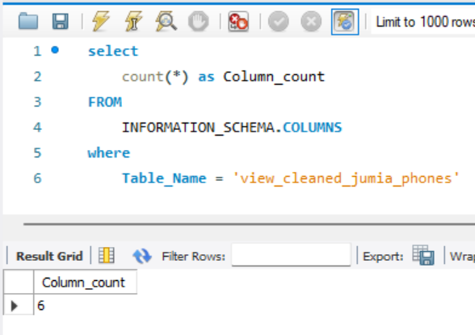
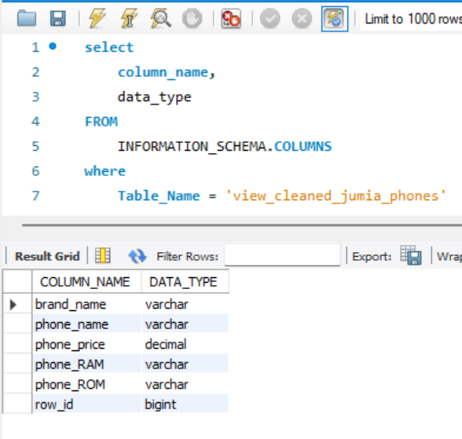
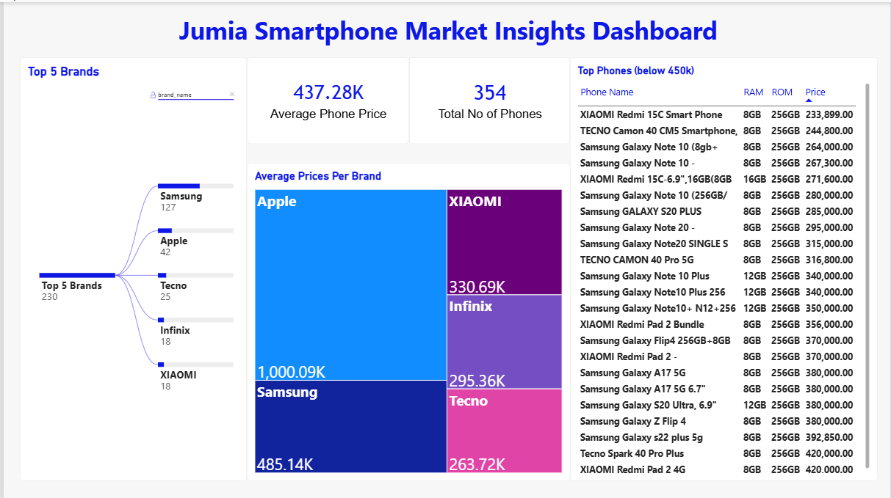
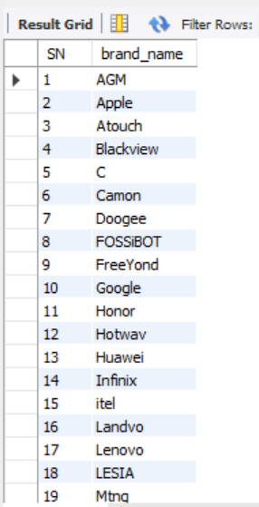
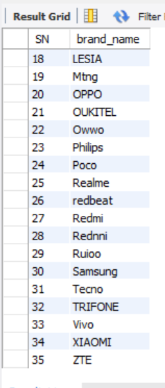
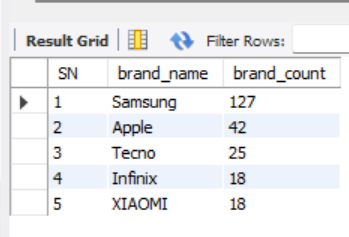

# Data-Driven Smartphone Selection: A Jumia Market Analysis
## Description
This project applies Excel, SQL, and Power BI to analyze smartphone listings from Jumia Nigeria, evaluate pricing and specifications, and identify the most suitable smartphone options based on budget, RAM, ROM, brand availability, and value for money. The analysis transforms raw product data into actionable insights to support informed, data-driven purchasing decisions.

 

## TABLE OF CONTENTS
- #### [Project Scope](#scope)
  - [Evaluation of Problem](#evaluation)
  - [Objective](#objective)
- #### [Data Identification](#identification)
  - [Data Source](#source)
  - [Data Availability & Compliance Checks](#data_availability_&_compliance_checks)
- #### [Data Acquisition & Extraction](#data_acquisition_&_extraction)
  - [Data Collection](#data_collection)
  - [Data Exploration](#data_exploration)
  - [Data Cleaning Notes](#data_cleaning_notes)
  - [Validation & Quality Checks](#Validation & Quality Checks)
- #### [Visualization](#Visualization)
  - [Results](#results)
  - [DAX Measures](#DAX Measures)
- #### [Analysis](#Analysis)
  - [Exploratory Data Analysis](#Exploratory Data Analysis)
  - [Discovery](#discovery)
- #### [Recommendations](#Recommendations)
  - [Potential Courses of Action](#Potential Courses of Action)
  - [Estimated Impact of Choice](#Estimated Impact of Choice)
- #### [Conclusion](#Conclusion)

## PROJECT SCOPE
### EVALUATION OF PROBLEM
A friend is asking for recommendations on a possible choice of phone. The key or core features that she’s looking for in the phone are RAM (Phone processor) and ROM (Phone Memory). She has a budget of N300k – N450k to make the purchase. Also, she wants a brand that is common that the spare parts can be easily sourced in the case of phone damage and repair.

### OBJECTIVE
The goal, aim or objective of this project is to get an idea on the details and prices of phones to enable her make a choice. So, she’s looking to make a choice based on the;
  -	Phone Brand
  -	Phone RAM
  -	Phone ROM; and 
  -	Phone price (N300k – N450k)

With these, this our analytical project will be answering the following key questions;
1.	How many phone brands do we have from the listing?
2.	Which are the top 5 brands with the most (common) listing?
3.	What are the RAM ranges of the phones under the price category (N300k – N450k)?
4.	What are the ROM ranges of the phones under the price category (N300k – N450k)?
5.	Which phones give the best value for money in terms of Brand, ROM and RAM? 

 

## DATA IDENTIFICATION
### DATA SOURCE
Since the purchase will be made from local stores in the country, we needed to a place where the prices of different phones are listed to give us an idea of what the prices might be. There are many sites that sell phone online, but for the safety, quality, accuracy and originality, we decided to use the most common or popular one, Jumia Online Stores. We will get the current phone listing from Jumia Official Website (www.jumia.com.ng).
### DATA AVAILABILITY AND COMPLIANCE CHECKS
We extracted 400+ rows of phone listing, which had;
  •	Phone names
  •	Brand names
  •	Phone RAM
  •	Phone ROM
  •	Colour
  •	Network strength
  •	Battery strength
  •	Seller store
  •	Phone initial price
  •	Discount
  •	Phone price after discount
  •	Rating reviews
  •	Normal rating
  •	Payment status
  •	Carts
  •	Promo status
  •	Store

What we need;
  -	Phone names
  -	Phone RAM
  -	Phone ROM
  -	Phone initial price
  -	Phone price after discount

 

## DATA ACQUISITION & EXTRACTION
### DATA COLLECTION
We used Power Query to access the Jumia Official webpage to extract the data from the site.

		POWER QUERY CODE
		let
		    Pages = List.Numbers(6, 25),
		    Tables = List.Transform(Pages, each fnJumiaPage(_)),
		    Combined = Table.Combine(Tables)
		in
		    Combined

### DATA EXPLORATION
Data exploration notes;
1.	Contains 412 rows
2.	Has 10 columns 
3.	Contains a lot of missing values in all columns except columns 1 & 2.
4.	We will only be needing phone name, phone storage and processor (if available), phone price and company name. so other columns will be removed.
5.	There was an OUKITEL Phone that has a 24GB RAM 256 ROM, yet, it was cheap. We investigated it and found out that it was a discount offer from one of the sellers.

### DATA CLEANING NOTES
1.	After exploring the already collected data with Excel, we pulled it into MySQL workbench for cleaning.
2.	While the data was pulled in, we encountered several errors that prevented the data from being imported properly. We;
    -	Re-saved the file as ‘CSV UTF 8’ file.
    -	Changed the datatype of the columns to ‘VARCHAR’.
This allowed for smooth loading of the table.
3.	We added the following columns;
    -	brand_name (represents the phone brand)
    -	phone_name (each phones name only) – trimmed to maximum of 30 characters.
    -	phone_ROM (each phone’s ROM if available)
    -	phone_RAM (each phone’s RAM if available)
    -	row_id (to make each row unique)
4.	We have about 412 rows of phone listings from different stores (sellers). But during deduplication, we keep getting some listed as duplicates despite rating_reviews showing different ratings (pertaining to the seller). So, we decided to identify each row with a store name. Since the objective is to get the best phone as regards the Phone name, brand, price, RAM and ROM, we carried on despite the fact that different phones can be listed by the same seller or store.

5.	We removed any row which any of these columns were not containing any value;
    -	brand_name
    -	phone_RAM
    -	phone_ROM

6.	The extracted columns and rows in the data were placed in an SQL view, known as view_cleaned_jumia_phones.

### VALIDITY AND QAULITY CHECKS
We need the following columns for our analysis;
1.	row_id
2.	brand_name
3.	phone_name
4.	phone_price
5.	phone_ROM
6.	phone_RAM
And they’re all available.

#### We’ll be performing the following validity and compliance checks;

<ins>ROW COUNT</ins>

 

<ins>COLUMN COUNT</ins>

 

<ins>DATA TYPES CHECK</ins>

 

<ins>DUPLICATE CHECK</ins>

We ran a duplicate check on the main table (jumia_phone_staging) where we confirmed that we had listings from different sellers. We added a tag to represent each unique poster/seller.

 

 

## VISUALIZATION
### RESULTS

 

### DAX Measures
<ins>Average Phone Price</ins>
.png)
 

<ins>Total No of Phones</ins>
.png)
 

 

## ANALYSIS
### EXPLORATORY DATA ANALYSIS
<ins>FINDINGSs</ins>

What did we find?

For this analysis, we need to focus on the following questions;
  1.	How many phone brands do we have from the listing?
  2.	Which are the top 5 brands with the most (common) listing?
  3.	What are the RAM ranges of the phones under the price category (N300k – N450k)?
  4.	What are the ROM ranges of the phones under the price category (N300k – N450k)?
  5.	Which phones give the best value for money in terms of Brand, ROM and RAM?
 

From our Dataset, we have;

<ins>1. Phones brands listed</ins>

We have about 35 different Phone brands in the phone listing

 

<ins>2.	Top 5 brands in the listing</ins>

 

<ins>3.	Phone RAM in the category (less than or equal to 450k)</ins>

.png)
 

<ins>4.	Phone ROM in the category (less than or equal to 450k)</ins>

.png)
 

<ins>5.	Phones with the best value for money</ins> in terms of Brand, ROM and RAM. To investigate this, we will look into the following;

- Only phones from the Top 5 brands will be considered.
        - Samsung
        - Apple
        - Tecno
        - Infinix
        - Xiaomi
- Given the availability of higher ROMs, it won’t be financially wise to look into lower ones such as 64GB & 32GB. Therefore, we’ll be focusing on 128GB, 256GB and 512GB.
- Likewise, we won’t be looking into RAMs within the range of 2-6 GB. Rather we’ll focus on 8GB, 16GB and 24GB.
 

Top 5 Samsung phones (below N450k)

.png)

 

Top 5 Apple phones (below N450k)

There are no Apple phones below 450k phone RAMs of 8GB and higher, or phone ROMs of 128GB and higher.

 

Top 5 Tecno phones (below N450k)

.png)

 

Top 5 Infinix phones (below N450k)

.png)

 

Top 5 XIAOMI phones (below N450k)

.png)

 

<ins>Best value by brand</ins>

| Phone Brand | Phone Name               | Price (N) | Phone ROM | Phone RAM |
| ----------- | ------------------------ | --------- | --------- |---------- |
| SAMSUNG     | Samsung Galaxy Note 10+  | 264,000   | 256GB     | 8GB       |  
| APPLE       | null                     | null      | null      | null      |  
| TECNO       | Tecno Camon 40 CM5       | 244,800   | 256GB     | 8GB       |  
| INFINIX     | Infinix Note 40          | 229,920   | 256GB     | 8GB       |  
| XIAOMI      | XIAOMI Redmi 15C         | 233,899   | 256GB     | 8GB       | 

 

  <INS>NB:</INS>There were 3 different listings of Infinix Note 40, so we used the average of the 3 of them.
 

### DISCOVERY

We discovered that;

    -	there are 35 unique phone brands listed
    -	the top 5 brands include; Samsung, Apple, Tecno, Infinix and XIAOMI.
    -	the maximum phone RAM across the Top 5 brands is 8GB.
    -	the maximum phone ROMs across the Top 5 brands are 128GB & 256GB.
    -	the cheapest amongst them is 229,920.

 

## RECOMMENDATIONS

### POTENTIAL COURSES OF ACTION

From our analysis, there are 4 possible recommendations:
 

<ins>FIRST CHOICE – Tecno Camon 40 CM5</ins>
 
<ins>Pros</ins>
-	affordable
-	common in the locale
-	accessories are available and relatively cheap

<ins>Cons</ins>
-	capacity limited
-	might overheat subsequently
-	decent battery strength and capacity
-	possible phone lags
 

<ins>SECOND CHOICE – Samsung Galaxy Note 10+</ins>
<ins>Pros</ins>
-	highly efficient
-	durable
-	accessories are available
-	stable network
	
<ins>Cons</ins>
-	accessories are quite very expensive (seriously consider)

<ins>THIRD CHOICE – Infinix Note 40</ins>
<ins>Pros</ins>
-	affordable
-	common in the locale
-	accessories are available and relatively cheap

<ins>Cons</ins>
-	possible phone lags
-	might overheat subsequently
-	low durability
-	decent battery strength and capacity

<ins>FOURTH CHOICE – XIAOMI Redmi 15C</ins>
<ins>Pros</ins>
-	affordable
-	fairly efficient

<ins>Cons</ins>
-	not common in the locale
-	accessories are not easily available
-	might overheat subsequently

I’d personally recommend that this would be definitely the last choice. In fact, only if others are not found.
 

### ESTIMATED IMPACT/CONSEQUENCES OF CHOICE

Since the purchase will be offline, i.e., via a physical location or local retail shop, the following I to be considered;
-	import fee or retailing fee (N10,000)
-	higher prices (as a result of the locale) and lack of discounts (N10,000)

So, adding the expected N20k+, we have;

| Phone Brand | Phone Name               | Price (N) | New Price (N) |
| ----------- | ------------------------ | --------- | ------------- |
| TECNO       | Tecno Camon 40 CM5       | 244,800   | 264,800       |  
| SAMSUNG     | Samsung Galaxy Note 10+  | 264,000   | 284,000       | 
| INFINIX     | Infinix Note 40          | 229,920   | 249,920       | 
| XIAOMI      | XIAOMI Redmi 15C         | 233,899   | 233,899       |

 

## CONCLUSION

This project successfully demonstrated how Excel, SQL, and Power BI can be used to transform raw smartphone listings into meaningful insights that support informed purchasing decisions. By analyzing 412 phone listings from Jumia, the project identified 35 smartphone brands and highlighted Samsung, Apple, Tecno, Infinix, and Xiaomi as the five most frequently listed brands. Further analysis focused on smartphones within the ₦300,000–₦450,000 budget range (or below 450k), prioritizing RAM, ROM, affordability, brand availability, and ease of sourcing accessories and spare parts.

Based on the findings, the Tecno Camon 40 CM5 emerged as the first-choice recommendation, offering a balance of affordability, storage capacity, and local availability. The Samsung Galaxy Note 10+ was identified as an alternative for its perceived efficiency and durability, while the Infinix Note 40 and Xiaomi Redmi 15C provided additional options at competitive prices. The analysis also accounted for estimated additional offline purchasing costs, demonstrating the importance of considering the total cost of acquisition rather than online prices alone.

Overall, this project highlights the value of data analytics in solving practical business and consumer problems. It demonstrates the application of data extraction, cleaning, validation, SQL querying, DAX measures, and visualization to produce actionable recommendations. Although prices, stock availability, and product specifications may change, the analytical approach provides a structured framework for comparing alternatives and making evidence-based purchasing decisions.

 

